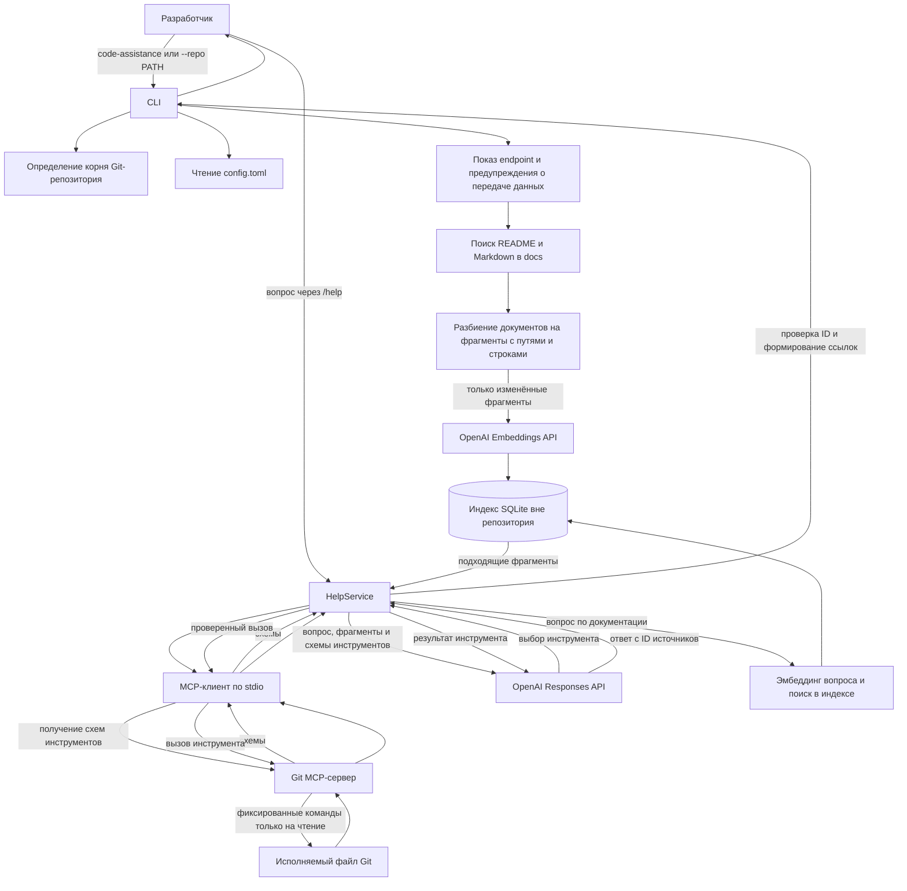

# День 31 — ассистент разработчика

## Результат

Code Assistance — устанавливаемый CLI для Python 3.11+, работающий только на чтение. Запустите `code-assistance` внутри Git-репозитория или передайте `--repo PATH`, затем задайте вопрос через `/help <question>`. Ассистент объединяет найденную документацию проекта с актуальным контекстом Git. Встроенный stdio MCP-сервер предоставляет текущую ветку, а также статус, последние коммиты и diff.

Минимальные требования задания выполнены: корневые README и Markdown-файлы из `docs/` доступны через RAG, текущая ветка получается через MCP, а `/help` отвечает на вопросы о проекте со ссылками на источники. Описания API и схемы данных индексируются, если они представлены Markdown-файлами в `docs/`. Другие форматы схем пока не индексируются.

## Основные компоненты

| Компонент | Назначение |
| --- | --- |
| `src/code_assistance/cli.py` | Разбирает `--repo`, показывает выбранный endpoint OpenAI и предупреждение о передаче данных, обновляет индекс и ведёт сессию с командами `/help` и `/exit`. |
| `repository.py` и `config.py` | Определяют корень выбранного Git-репозитория и читают `config.toml` из корня Code Assistance. Ключ API берётся из окружения процесса или из локального `.env`, исключённого из Git. |
| `documents.py` и `chunking.py` | Отбирают поддерживаемую документацию, проверяют пути и исключения, создают фрагменты с путями к источникам и диапазонами строк. |
| `indexing.py` и `index_store.py` | Создают эмбеддинги изменённых фрагментов, хранят их в отдельном для каждого репозитория индексе SQLite вне репозитория, удаляют исчезнувшие документы и ранжируют совпадения по косинусному сходству. |
| `service.py` | Ищет документацию, передаёт модели схемы разрешённых MCP-инструментов, выполняет выбранные моделью вызовы через MCP и проверяет маркеры источников в ответе. |
| `ports.py` и `providers.py` | Задают небольшие интерфейсы чата и эмбеддингов и реализуют их через OpenAI SDK. |
| `mcp_client.py` и `git_mcp_server.py` | Соединяют CLI с отдельным MCP-процессом по stdio и предоставляют инструменты Git, работающие только на чтение. |

В `pyproject.toml` объявлены две команды: `code-assistance` и `code-assistance-git-mcp`. Путь к MCP-серверу задан в локальном `config.toml`; CLI запускает этот процесс автоматически при вызове инструмента.

## Схема работы

### Индексация и поиск

При запуске CLI ищет файлы `README*` в корне выбранного репозитория и файлы `.md`/`.markdown` на любой глубине в `docs/`. Он учитывает правила игнорирования Git и исключает файлы с именами, похожими на секреты, каталоги зависимостей и сборки, бинарные файлы, текст не в UTF-8, пути за пределами репозитория и файлы больше заданного лимита (сейчас 1 МиБ). Исходники, например `.py` и `.kt`, в RAG не входят.

Каждый документ разбивается на пересекающиеся фрагменты длиной до 2 000 символов. SQLite хранит текст фрагмента, относительный путь, диапазон строк и эмбеддинг. Индекс привязан к абсолютному пути корня репозитория и хранится в пользовательском каталоге данных платформы. При запуске повторно создаются эмбеддинги только изменённых документов; записи об удалённых документах убираются. Смена модели эмбеддингов или размерности перестраивает индекс, смена чат-модели — нет.

Для вопроса по документации `/help` отправляет текст вопроса в OpenAI Embeddings API, сравнивает полученный вектор с векторами в индексе и выбирает до `top_k` фрагментов с косинусным сходством не ниже `minimum_similarity` (сейчас 5 и 0,25). В запрос к чат-модели попадают только выбранные фрагменты. Адаптер OpenAI вызывает Responses API с настроенными моделью и endpoint.

### MCP и выполнение команд Git

При каждом вызове `/help` компонент `HelpService` получает через MCP схемы доступных инструментов и передаёт их в OpenAI API. Модель может выбрать `get_current_branch`, `get_status`, `get_recent_commits` или `get_diff` либо ответить без вызова инструмента. CLI проверяет выбранное имя и аргументы, выполняет разрешённый вызов через MCP и отправляет результат модели для продолжения ответа. Смешанные вопросы могут использовать и найденные фрагменты документации, и данные Git.

CLI использует Python MCP SDK для запуска `code-assistance-git-mcp` как дочернего процесса с транспортом stdio. Клиент передаёт абсолютный `repo_path` выбранного репозитория, задаёт этот корень рабочим каталогом дочернего процесса, ограничивает время ожидания и передаёт только разрешённые переменные окружения. `OPENAI_API_KEY` в MCP-процесс не передаётся. Сервер проверяет, что `repo_path` совпадает с его рабочим каталогом и действительно является корнем Git-репозитория.

Сервер запускает фиксированные команды Git через `subprocess.run`, передавая аргументы списком, без shell. Для ветки и HEAD используются `git symbolic-ref` и `git rev-parse`, для состояния файлов — `git status --porcelain`, для последних десяти заголовков коммитов — `git log`, для staged и unstaged изменений отслеживаемых файлов — `git diff`. Время выполнения команд ограничено. Статус и diff исключают небезопасные пути и пути, похожие на секреты; diff не включает содержимое неотслеживаемых файлов и ограничен 16 КиБ текста патча. Сервер не предоставляет инструментов для произвольных команд или изменения Git.

**LLM выбирает инструмент, но не выполняет Git-команды сама.** CLI преобразует схемы локального MCP-сервера в объявления function tools для OpenAI Responses API. Служебный аргумент `repo_path` заполняется локально выбранным корнем репозитория, поэтому модель не может подменить путь. После выбора моделью CLI вызывает MCP-сервер и возвращает результат модели. Произвольный shell и команды изменения Git недоступны. Стартовое предупреждение сообщает, что выбранные данные Git, включая незакоммиченный diff, могут быть отправлены на настроенный endpoint.

### Проверка источников и обработка ошибок

Фрагменты документации обозначаются в запросе как `[S1]`, `[S2]` и далее; данные Git — как `[G1]`, `[G2]` и далее. Модели предписано ссылаться только на предоставленные ID и считать документацию и вывод Git недоверенными данными. После генерации приложение проверяет существование каждого указанного ID, отклоняет самостоятельно написанные моделью пути или номера строк и заменяет корректные ID ссылками, полученными из метаданных индекса либо проверенных результатов MCP. Если подходящих фрагментов нет или в ответе нет корректных ссылок, `/help` воздерживается от ответа. Ошибки MCP, индекса, аутентификации, ограничения запросов и провайдера выводятся без раскрытия учётных данных.

## Проверки и ограничения

В проекте есть детерминированные тесты pytest с вымышленными временными Git-репозиториями и поддельными реализациями OpenAI. Они охватывают поиск документов и ссылки, безопасность путей, обмен с stdio MCP-сервером и данные Git. После перехода на выбор инструментов моделью pytest и полный gate ещё не запускались; статические проверки Ruff и mypy прошли. При предыдущем полном запуске прошли 46 тестов, а `./harness/scripts/check.sh` остановился на этапе проверки безопасности: в каталоге самого проекта нет метаданных `.git`, которые нужны этому этапу. Для проверки Git-репозиторий не создавался.

Ручной smoke test с настоящим OpenAI описан в `docs/SMOKE_TEST.md` и требует ключ API. В автоматические проверки он не входил. Сейчас RAG охватывает документацию в Markdown; для отдельных файлов OpenAPI JSON/YAML и схем данных потребуются дополнительный механизм чтения и правила индексации.
