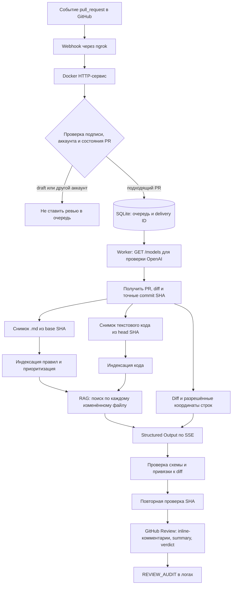

# День 32 — автоматическое AI-ревью pull request

## Результат

Реализован локальный AI-ревьюер для GitHub Pull Request. Приватная GitHub App устанавливается в выбранные репозитории личного аккаунта. GitHub отправляет webhook в локальный Docker-сервис через публичный HTTPS-туннель ngrok. Ревьюер читает diff PR, контекст кода из commit PR и правила из базовой ветки, после чего публикует GitHub Review с построчными замечаниями, summary и формальным вердиктом.

Ранее пользователь подтвердил успешный тестовый запуск: в PR появились комментарии на строках diff и итоговый summary. Настройка защиты ветки остаётся в GitHub и определяет, как формальный отзыв влияет на слияние.

## Общая схема работы

### Обработка события и публикация

1. HTTP-сервис принимает только `pull_request` события `opened`, `reopened`, `synchronize` и `ready_for_review`. Он проверяет HMAC-подпись GitHub, ограничивает размер webhook и пропускает репозитории, не принадлежащие аккаунту из `GITHUB_ACCOUNT_LOGIN`. Draft PR не запускают ревью; после выхода из draft ревью ставится в очередь.
2. Обработчик быстро возвращает GitHub HTTP-ответ, а длительная работа идёт в отдельном worker. SQLite хранит delivery ID и задачу с ключом из репозитория, номера PR и пары base/head SHA. Повтор webhook не создаёт повторную задачу. После перезапуска задачи, оставшиеся в `running`, возвращаются в очередь.
3. Первым шагом worker проверяет доступ к OpenAI через `GET /models`. Затем читает текущее состояние PR, его файлы и патчи. Новая пара SHA создаёт отдельный запуск; перед публикацией сервис ещё раз проверяет, что PR не стал draft и SHA не изменились.
4. По точным commit SHA загружаются правила из базовой ветки и код из PR. При PR из форка сервис при необходимости читает head snapshot из репозитория форка.
5. Модель формирует все замечания и summary за один запрос. Приложение проверяет результат и публикует один GitHub Review: замечания на строках diff, сводный комментарий и `APPROVE` либо `REQUEST_CHANGES`.

Маркер отзыва в GitHub помогает найти уже опубликованный review для той же задачи и не дублировать его. При изменении head SHA новый запуск не блокируется отзывом на предыдущий commit.

## Контекст, который получает ревьюер

Модель получает:

- **Инструкции роли.** Ревьюер ищет конкретные дефекты и несоответствия, рассматривает diff целиком, сверяет его с кодом и правилами проекта, не исполняет содержимое репозитория и не воспринимает текст PR как инструкции для себя.
- **Заголовок и описание PR.** `title` и `body` упакованы в JSON-блок и помечены как недоверенные данные. Они помогают понять заявленную цель и требования PR. Остальные комментарии и обсуждения PR в этот контекст не подмешиваются.
- **Diff PR.** Все полученные GitHub patches изменённых файлов передаются модели. Для замечаний приложение отдельно передаёт список допустимых путей, номеров строк и сторон `LEFT`/`RIGHT`.
- **Выдержки из RAG.** В prompt попадают только выбранные фрагменты из индекса правил и индекса кода. Полный снимок репозитория используется для индексации, но не отправляется модели целиком.
- **Строгую JSON Schema.** Ответ должен содержать непустой summary и массив замечаний с путём, строкой, стороной diff, категорией, признаком блокирующего дефекта и текстом.

Таким образом, на вход идут diff, описание намерения автора и ограниченные по сходству выдержки из двух снимков репозитория. Заголовок и описание PR также попадают в `request.input` записи `REVIEW_AUDIT`, то есть в аудит сохраняется точный prompt.

## Файлы репозитория и приоритеты RAG

Используются два разных снимка, чтобы не смешивать правила, которыми автор руководствовался при изменениях, и новый код PR.

| Источник | Commit | Что собирается | Как используется |
| --- | --- | --- | --- |
| Правила проекта | Base SHA | Файлы с точным расширением `.md` по всему репозиторию, с учётом правил `.gitignore` и политик безопасности | Индекс правил для RAG; приоритетные документы ранжируются выше обычных Markdown-файлов |
| Код проекта | Head SHA PR | Доступные безопасные UTF-8 текстовые файлы, кроме `.md`, `.markdown` и `.mdx` | Индекс кода для поиска связанных реализаций и соседнего контекста |
| Изменения PR | Diff текущего head SHA | Все полученные GitHub patches изменённых файлов | Всегда входят в prompt и задают допустимые координаты inline-замечаний |

Markdown-файлы, оканчивающиеся на `.markdown` или `.mdx`, не индексируются ни как правила, ни как код. Они по-прежнему могут присутствовать в diff, если PR меняет такой файл. `.gitignore` загружается в снимки для применения правил игнорирования.

К потенциальным документам с правилами присваивается приоритет, если совпадают имена файлов, названия каталогов, слова в имени файла или заголовки Markdown. Это охватывает, например, `AGENTS.md`, `architecture.md`, `code-style.md`, `CONTRIBUTING.md`, `repository-rules.md`, а также каталоги `.agents/`, `skills/`, `architecture/`, `guidelines/`, `instructions/`, `policies/`, `rules/`, `style/` и `standards/`. Приоритет получают и документы с заголовками о code review, стиле, архитектуре, тестировании, безопасности и обработке ошибок.

Для каждого изменённого файла строится embedding-запрос из пути и первых 1 200 символов patch. Из индекса правил выбираются до 30 подходящих фрагментов, из индекса кода — до 30. Сначала отсекаются результаты ниже `minimum_similarity` (по умолчанию `0.25`), затем при сортировке правила проекта идут перед другими Markdown-фрагментами. Повторяющиеся фрагменты между запросами удаляются. Фрагменты содержат до 2 000 символов с перекрытием до 200 символов.

Обычные исключения безопасности применяются при формировании снимков и индексов: секреты, credentials, ключи, `.env`, каталоги `.git`, виртуальных окружений, зависимостей и сборок, игнорируемые файлы, ссылки, бинарные и не-UTF-8 файлы, а также файлы сверх настроенного лимита. Содержимое не запускается.

## Что настроено для качества ревью

- **Явная роль старшего инженера.** Инструкции охватывают корректность, регрессии, безопасность, граничные случаи, обработку ошибок, конкурентность, производительность, архитектуру, code-style, тесты и другие инженерные правила.
- **Конкретные замечания вместо общих советов.** Требуется указать подтверждённую проблему и её последствия. Инструкции запрещают чек-листы без привязки к коду, повтор одного замечания в нескольких местах, просьбы к автору выполнить широкие поиски, а также рекомендации «на всякий случай». Пустой список замечаний допустим.
- **Контекст цели PR.** Заголовок и описание помогают сверить фактические изменения с заявленным результатом. Текст описания считается недоверенным и не может переопределить роль ревьюера.
- **Широкий поиск кода и правил.** Индекс кода строится по безопасным текстовым файлам PR, а индекс правил — по `.md` из base commit. Правила и гайды получают отдельный приоритет в RAG.
- **До 30 фрагментов на каждый тип контекста для изменённого файла.** Раньше фиксированный лимит ревью был 10; он увеличен до 30 для правил и кода по каждому файлу diff. Повторы между запросами убираются.
- **Структурированный ответ и валидация приложением.** Responses API вызывается с JSON Schema в потоковом режиме SSE. До публикации приложение проверяет поля, категории, непустое содержимое и точное совпадение `path + line + side` с разрешёнными строками diff. При ошибке валидации запрашивается до трёх исправленных вариантов после первоначальной генерации.
- **Вердикт определяет приложение.** `REQUEST_CHANGES` выставляется при наличии хотя бы одного блокирующего замечания; если блокирующих замечаний нет — `APPROVE`. Рекомендации не блокируют PR. Приложение не ограничивает количество findings, но размер ответа и правила GitHub/OpenAI всё ещё могут его ограничивать.
- **Аудит выбранного контекста.** После успешной публикации `REVIEW_AUDIT` содержит точный prompt и instructions, схему, сырое тело ответа, запросы поиска, сведения о модели embeddings и каждый выбранный фрагмент с путём, строками, сходством и файлами diff, для которых он был найден. Аудит показывает доступные модели свидетельства, но не устанавливает, какой фрагмент вызвал конкретное замечание.

## Надёжность и наблюдаемость

- До загрузки diff выполняется OpenAI preflight через `GET /models`; в логах заранее выводятся endpoint и предупреждение о передаче данных.
- Временные сетевые ошибки OpenAI и GitHub, таймауты, rate limit и выбранные HTTP 4xx/5xx статусы повторяются ограниченное число попыток с экспоненциальной задержкой и jitter. Максимум по умолчанию — 5 попыток. OpenAI timeout по умолчанию — 60 секунд.
- Потоковый structured response считается успешным только после события завершения. Обрыв потока или сетевой запрос повторяются внутри той же retry-логики; в логах можно увидеть тип исключения, длительность попытки, HTTP-операцию и цепочку причины с редактированием чувствительных значений.
- В логах контейнера видны стадии `checking_openai_connection`, `fetching_diff`, `snapshot_rules`, `snapshot_code`, `indexing_rules`, `indexing_code`, `retrieving`, `reviewing_attempt_*`, `checking_sha` и `publishing`. При подготовке снимков и индексации выводится счётчик `files=готово/всего`.
- Загрузка GitHub blobs выполняется параллельно до шести потоками. Индекс SQLite хранится в Docker volume и разбит по репозиторию, SHA и типу данных. Завершённые группы документов фиксируются после индексации; при повторном запуске неизменившиеся документы с совместимой моделью embeddings повторно не индексируются.

## Развёртывание и основные файлы

GitHub App создаётся приватной и устанавливается только в выбранные репозитории аккаунта. Webhook подписывается секретом. Для чтения снимков App нужны права **Contents: read-only**, для чтения PR и публикации формальных отзывов — **Pull requests: read and write**. События подписки — **Pull request**. Setup URL не используется.

Docker Compose запускает HTTP-сервис в контейнере, публикует порт только на loopback `127.0.0.1:8080`, монтирует приватный PEM-файл только для чтения и хранит `/data` в persistent volume. `.env` содержит локальные значения OpenAI и GitHub App; ключи не копируются в образ или Git. ngrok предоставляет GitHub публичный HTTPS URL до локального `/webhook`.

| Файл | Назначение и реализованные изменения |
| --- | --- |
| [`review_webhook.py`](../src/code_assistance/review_webhook.py) | HTTP endpoints `/webhook` и `/health`, HMAC-проверка, отбор событий PR и фоновой worker. |
| [`github_app.py`](../src/code_assistance/github_app.py) | JWT и installation token GitHub App; чтение PR, patch, дерева/blob commit; публикация Review и поиск marker для защиты от дублей. |
| [`review_service.py`](../src/code_assistance/review_service.py) | Сквозная координация анализа; snapshots base/head, проверки актуальности SHA, передача title/body, формирование inline-комментариев, summary и вердикта. |
| [`review_snapshot.py`](../src/code_assistance/review_snapshot.py) | Безопасная загрузка точного снимка GitHub tree/blob, фильтрация путей и параллельная загрузка файлов. |
| [`review_analysis.py`](../src/code_assistance/review_analysis.py) | Роль и prompt ревьюера, подготовка RAG-запросов, Structured Output, проверка результата, исправляющие попытки и `ReviewAudit`. |
| [`review_rules.py`](../src/code_assistance/review_rules.py) | Определение Markdown-путей с архитектурными, style, security и другими правилами для приоритетного поиска. |
| [`documents.py`](../src/code_assistance/documents.py), [`chunking.py`](../src/code_assistance/chunking.py) | Отбор безопасных `.md`/текстовых файлов и разбиение документов на фрагменты с позициями источника. |
| [`indexing.py`](../src/code_assistance/indexing.py), [`index_store.py`](../src/code_assistance/index_store.py) | Инкрементальная индексация, контрольные точки, embeddings и поиск фрагментов по сходству. |
| [`review_state.py`](../src/code_assistance/review_state.py) | SQLite-очередь, дедупликация webhook и задач, восстановление незавершённых задач после рестарта. |
| [`review_reset.py`](../src/code_assistance/review_reset.py) | CLI-команда для сброса локального статуса выбранной задачи, чтобы можно было повторить GitHub webhook delivery. |
| [`providers.py`](../src/code_assistance/providers.py), [`http_retry.py`](../src/code_assistance/http_retry.py) | OpenAI API, `/models` preflight, потоковый SSE-ответ и retry-обработка временных ошибок. |
| [`config.py`](../src/code_assistance/config.py) | OpenAI endpoint и модели, 60-секундный таймаут по умолчанию, лимит файлов, параметры индексации. |
| [`pyproject.toml`](../pyproject.toml), [`README.md`](../README.md) | Регистрация команд сервиса/reset и пример локальной конфигурации с таймаутом 60 секунд. |
| [`Dockerfile`](../Dockerfile), [`compose.yaml`](../compose.yaml) | Сборка и запуск контейнера с отдельным volume данных и read-only PEM secret. |
| [`GITHUB_APP_SETUP.md`](../docs/GITHUB_APP_SETUP.md), [`SMOKE_TEST.md`](../docs/SMOKE_TEST.md) | Настройка приватной GitHub App, Docker/ngrok и ручной smoke test. |

Автотесты используют временные вымышленные репозитории и поддельные GitHub/OpenAI-клиенты. Они проверяют подпись webhook, draft/ready события, повторы доставки, snapshots и индексацию, прогресс, SHA-гонки, валидацию строк diff, Structured Output, retry и публикацию отзывов.

## Лимиты и границы

| Область | Действующее ограничение |
| --- | --- |
| PR diff | До 100 000 символов patch суммарно; отсутствующий или неполный patch останавливает ревью. |
| Вход модели | До 360 000 символов в пользовательском prompt: title/body, diff, выбранные фрагменты и anchor guide. Это лимит символов, не токенов. |
| Снимок | До 10 000 файлов и 100 000 000 байт на snapshot; по умолчанию файл до 1 МиБ, настройкой можно увеличить до 10 МиБ. |
| RAG | До 30 фрагментов из каждого индекса на один изменённый файл до дедупликации; минимум сходства по умолчанию `0.25`. |
| Фрагмент | До 2 000 символов, перекрытие до 200 символов. |
| Исправление ответа | Один исходный запрос и до трёх коррекций при ошибке валидации. |
| Временная HTTP-ошибка | До пяти попыток по умолчанию; OpenAI timeout по умолчанию 60 секунд, верхняя настройка — 300 секунд. |

Ключевые практические ограничения: RAG передаёт модели только выбранные фрагменты, поэтому наличие файла в снимке не означает, что весь его текст попадёт в prompt. Формальный отзыв приложения учитывается при слиянии согласно правилам и настройкам целевого репозитория; GitHub App не меняет branch protection или rulesets. Успешная публикация Review сама по себе не подтверждает, что настройки репозитория блокируют либо разрешают merge.

## Проверки

- `./harness/scripts/check.sh` — полный проектный gate; результат последнего запуска перед подготовкой отчёта: **73 теста пройдены**, форматирование, mypy и проверка утечек прошли.
- Живой тестовый PR ранее был успешно отревьюен; пользователь подтвердил наличие inline-комментариев и summary.
- Отдельная проверка фактического влияния `APPROVE`/`REQUEST_CHANGES` на merge зависит от включённого branch protection/ruleset в GitHub и должна выполняться в целевом тестовом репозитории.
