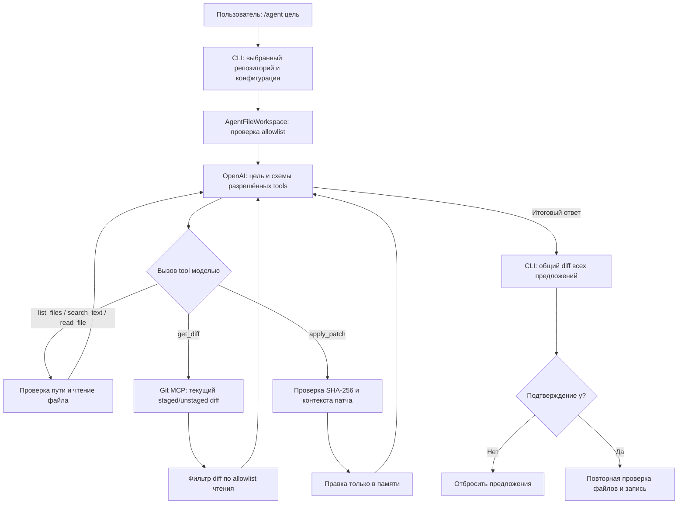

# День 34 — агент для работы с файлами проекта

## Результат

В локальном CLI добавлена команда `/agent <цель>`. Пользователь формулирует задачу на уровне результата; агент сам перечисляет файлы, ищет совпадения, читает код и предлагает точечные изменения. Он может учитывать текущие staged и unstaged изменения Git через `get_diff`. Изменения накапливаются в памяти, показываются единым diff и записываются только после ответа `y` на запрос подтверждения. Команда `/help` сохраняет отдельный сценарий ответов по документации и Git.

Текущая реализация рассчитана на выбранный Git-репозиторий (`--repo` или репозиторий текущего каталога). Доступ к файлам `/agent` закрыт, пока в `config.toml` не заполнены списки разрешённых каталогов и расширений.

## Общая схема `/agent`

1. CLI показывает endpoint и предупреждение о передаче разрешённых фрагментов кода в OpenAI. Затем создаёт рабочую область для выбранного репозитория и передаёт модели цель и схемы доступных инструментов.
2. Модель выбирает инструменты по необходимости. После каждого вызова CLI сообщает номер шага, имя инструмента и краткий результат без содержимого файлов и поискового запроса. Для `/agent` фиксированный лимит раундов модели и числа вызовов инструментов отключён; ограничения объёма файлов и результатов остаются.
3. `apply_patch` принимает один файл за вызов. Для существующего файла требуется SHA-256 текущей версии, полученный при чтении. Патч содержит строки контекста, удаления и добавления; контекст должен совпасть ровно в одном месте. Для нового файла используется `*** Add File` со строками `+`.
4. После итогового ответа модели CLI строит общий unified diff относительно исходного содержимого. При ответе, отличном от `y`, файлы не изменяются.
5. Перед записью CLI повторно сверяет исходное содержимое каждого файла и права доступа. При конфликте применение набора отклоняется. Файлы записываются через временные файлы и замену; при ошибке сообщаются пути файлов, которые уже успели измениться.

## Инструменты `/agent`

| Tool | Назначение | Результат и особенности |
| --- | --- | --- |
| `list_files(prefix?)` | Перечислить разрешённые файлы, при необходимости внутри каталога. | Список путей и признак усечения; максимум 200 путей за ответ. |
| `search_text(query, prefix?)` | Найти буквальное вхождение строки без учёта регистра в разрешённых файлах. | Путь, номер строки и фрагмент до 300 символов; максимум 30 совпадений. Поиск ограничен 2 000 файлами и 5 МиБ прочитанного текста. |
| `read_file(path)` | Прочитать разрешённый UTF-8 файл и получить базу для изменения. | Содержимое файла и его SHA-256. Для файла действует предел 128 КиБ. |
| `apply_patch(patch, expected_sha256)` | Подготовить точечную правку существующего файла или создать новый файл. | Проверяет путь, исходный хеш и точное совпадение контекста; меняет только представление файла в памяти. |
| `get_diff()` | Получить текущий diff отслеживаемых файлов через Git MCP, если сервер настроен и инструмент доступен. | Staged и unstaged patches после фильтрации по allowlist чтения. Неотслеживаемые файлы не включаются; Git MCP ограничивает суммарный patch примерно 16 КиБ и помечает усечение. |

`get_diff` — инструмент существующего Git MCP, подключённый к `/agent` через MCP-клиент. Остальные четыре инструмента реализованы локально в CLI. Генерация итогового diff и запись файлов — действия приложения после работы модели, а не отдельные доступные ей tools.

## Доступ и безопасность

- Текущий локальный `config.toml` разрешает читать `src`, `tests`, `docs`, `harness`, `README.md` и `pyproject.toml` с расширениями `.py`, `.md`, `.toml`, `.sh`. Запись разрешена в `src`, `tests`, `docs`, `README.md` и `pyproject.toml` с расширениями `.py`, `.md`, `.toml`. Этот файл конфигурации локален и исключён из Git.
- На каждый путь действуют проверка относительности к выбранному репозиторию, запрет `..` и скрытых компонентов, обязательные исключения для `.env*`, ключей, учётных данных, `.git`, зависимостей и сборочных каталогов, правила Git ignore и запрет символических ссылок. Читаются только обычные UTF-8 файлы в пределах размера.
- `get_diff` не передаёт модели patch файла, который агент не может прочитать по своей файловой политике. Проверка применяется после получения данных через MCP и до формирования ответа модели.
- Модель не получает произвольный shell, запись в Git или прямую запись на диск. Сам процесс CLI работает с правами пользователя; запрет секретов реализован в файловых инструментах и потоке данных к модели, а не отдельной песочницей ОС.

## Поиск и применение правки

Для задачи вроде «обнови проверку email» агент может вызвать `list_files`, затем `search_text` по предполагаемому имени функции или вызову API, прочитать найденные файлы через `read_file` и составить патч. `search_text` ищет буквальное совпадение строки; семантический RAG-поиск и AST-навигация в `/agent` не используются. Поиск по документации с эмбеддингами относится к команде `/help`.

При применении патча строки контекста и удаления сопоставляются с текущим текстом файла. Если нужный блок не найден или встречается неоднозначно, инструмент возвращает ошибку, и агент может перечитать файл и уточнить патч. Номера строк для применения не нужны.

## Проверки и текущее состояние

- Детерминированные тесты на вымышленных Git-репозиториях покрывают поиск по нескольким файлам, изменение кода и документации, создание файла, подтверждение и отказ, конфликт хеша, ошибку провайдера и частичную ошибку записи.
- Проверки безопасности покрывают `.env`, запрещённые и игнорируемые пути, выход через `..`, символические ссылки и отсутствие секретного содержимого в ответах поддельному провайдеру.
- Сквозной тест Git MCP подтверждает, что `/agent` получает staged и unstaged diff разрешённого файла, но не получает содержимое `.env` и файла вне allowlist.
- Последний запуск `./harness/scripts/check.sh` после подключения `get_diff` завершился успешно: 105 тестов, форматирование, проверка типов и сканирование секретов прошли.
- Изменения находятся в рабочем дереве без коммита. Реальный сеанс `/agent` с OpenAI этим набором тестов не проверялся.

## Ограничения

Патч поддерживает один файл за вызов и требует точного однозначного контекста; большие файлы и большие ответы поиска намеренно ограничены. `get_diff` показывает только отслеживаемые Git изменения и может быть усечён. Для исполнения кода, запуска тестов по выбору модели или языковой навигации по символам потребуются отдельные инструменты и отдельное решение по правам доступа.
